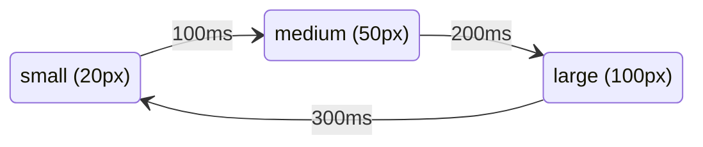

Angular has two ways to animate:

| Approach | Since | Use for |
| --- | --- | --- |
| **`animate.enter` / `animate.leave` + CSS** | v20.2 | new code: elements appearing/disappearing, using normal CSS animations |
| **`@angular/animations`** (`trigger`, `state`, `transition`…) | v2 | existing code; deprecated since v20.2 but still everywhere, and asked about in interviews |

Plain CSS transitions on a bound class (`[class.open]="isOpen"`) cover a lot too and need nothing from Angular.

## Native: `animate.enter` and `animate.leave`

The hard part of animating with plain CSS is **leaving**: when an `@if` turns false, the element is removed at once, so there's nothing left to animate. `animate.leave` tells Angular to add a class and **wait for its animation to finish** before removing the element.

```html
@if (show()) {
  <div class="panel" animate.enter="fade-in" animate.leave="fade-out">Hello</div>
}
```

```css
.fade-in  { animation: fade 300ms ease-in; }
.fade-out { animation: fade 200ms ease-out reverse; }
@keyframes fade { from { opacity: 0; transform: translateY(-8px); } to { opacity: 1; transform: none; } }
```

No module, no provider: it's built into the compiler.

## `@angular/animations` (the classic API)

Setup: add `provideAnimationsAsync()` to the providers in `app.config.ts` (module apps: import `BrowserAnimationsModule`). Then describe the animation in the component's `animations` array and attach it in the template with `[@triggerName]`.

| Function | Does |
| --- | --- |
| `trigger('name', [...])` | a named animation you bind with `[@name]="value"` |
| `state('value', style({...}))` | the styles to keep while the bound value equals `'value'` |
| `transition('a => b', [...])` | what to do when the value changes from `a` to `b` |
| `animate('300ms ease-in', style({...}))` | animate to these styles over a duration |
| `style({...})` | styles applied immediately (start point) |

### Animating between states

A box that grows from small → medium → large and back on each click:



```ts
@Component({
  selector: 'app-grow',
  template: `<div [@size]="size">Some text</div> <button (click)="next()">Toggle</button>`,
  animations: [
    trigger('size', [
      state('small', style({ height: '20px' })),
      state('medium', style({ height: '50px' })),
      state('large', style({ height: '100px' })),
      transition('small => medium', animate('100ms')),
      transition('medium => large', animate('200ms')),
      transition('large => small', animate('300ms')),
    ]),
  ],
})
export class Grow {
  size: 'small' | 'medium' | 'large' = 'small';
  next() {
    this.size = this.size === 'small' ? 'medium' : this.size === 'medium' ? 'large' : 'small';
  }
}
```

The bound value can be anything that turns into a string, including a boolean. A button per user that turns red and grows when inactive:

```ts
animations: [
  trigger('buttonState', [
    state('true', style({ background: '#04b104', transform: 'scale(1)' })),
    state('false', style({ background: '#e40202', transform: 'scale(1.1)' })),
    transition('true <=> false', animate('100ms ease-in-out')),   // <=> = both directions
  ]),
],
```

```html
@for (user of users; track user.id) {
  <button [@buttonState]="user.active" (click)="user.active = !user.active">{{ user.name }}</button>
}
```

### Entering and leaving

`:enter` and `:leave` are shortcuts for elements being **added** (`void => *`) and **removed** (`* => void`), e.g. by `@if` or `@for`:

```ts
trigger('appear', [
  transition(':enter', [
    style({ opacity: 0 }),                         // start here…
    animate('300ms ease-in', style({ opacity: 1 })),   // …end here
  ]),
  transition(':leave', [animate('200ms ease-out', style({ opacity: 0 }))]),
]),
```

```html
@if (visible) { <p @appear>Now you see me</p> }
```

### Timing strings

`animate('duration delay easing')`: `'300ms'`, `'0.3s 100ms'` (wait 100ms first), `'500ms ease-out'`, `'1s 200ms cubic-bezier(0.35, 0, 0.25, 1)'`.

Wildcards: `*` matches any state (`'* => *'` = every change); `void` is "not in the DOM".

> [!note] Very old imports
> Angular 2 imported these functions from `@angular/core` (`import { trigger, state, … } from '@angular/core'`). Angular 4 moved them to their own package, `@angular/animations`, so apps that don't animate don't pay for the code.

Related: [[06 Directives|Directives]] (`@if`, `@for` drive enter/leave), [[23 Change Detection and Performance|Performance]].
