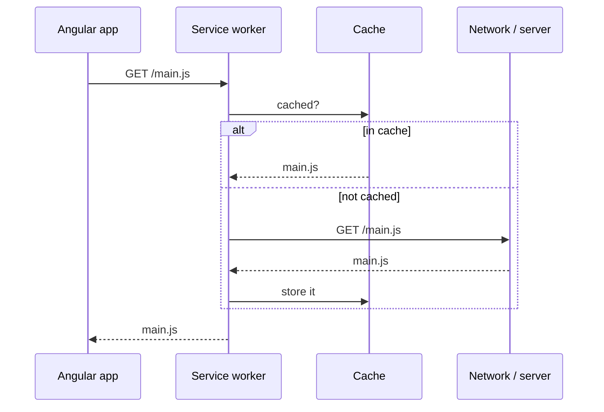

A **service worker** is a script the browser runs in the background, separate from the page. Once installed it stays on the user's device and sits **between the app and the network**: every request from your site goes through it, so it can answer from a cache instead.

That gives you:

- **Offline support:** the app still opens with no connection
- **Faster repeat visits:** files come from the cache, not the network
- **Controlled updates:** new versions download in the background

A **PWA (Progressive Web App)** is a web app that uses a service worker plus a web app manifest, so it can be installed like a native app (home-screen icon, own window).



## Adding it

```bash
ng add @angular/pwa
```

This installs `@angular/service-worker` and adds:

| File | Purpose |
| --- | --- |
| `ngsw-config.json` | what to cache and how (see below) |
| `public/manifest.webmanifest` | app name, colours, icons: makes it installable |
| `public/icons/` | app icons in several sizes |
| `provideServiceWorker(...)` in `app.config.ts` | registers the worker |
| `<link rel="manifest">` in `index.html` | points to the manifest |

```ts
// app.config.ts
provideServiceWorker('ngsw-worker.js', {
  enabled: !isDevMode(),                          // never in ng serve
  registrationStrategy: 'registerWhenStable:30000',
}),
```

## Trying it out

The service worker only runs in a **production build** served over HTTPS (or `localhost`). `ng serve` doesn't use it.

```bash
ng build
npx http-server -p 8080 -c-1 dist/my-app/browser
```

Open `http://localhost:8080`, then **DevTools → Application → Service Workers**. You should see the worker activated and running:

![[service-worker-devtools.jpg]]

Tick **Offline** and reload: the app still loads. **Update on reload** and **Bypass for network** are handy while developing.

## `ngsw-config.json`

```json
{
  "index": "/index.html",
  "assetGroups": [
    { "name": "app", "installMode": "prefetch",
      "resources": { "files": ["/favicon.ico", "/index.html", "/*.css", "/*.js"] } },
    { "name": "assets", "installMode": "lazy", "updateMode": "prefetch",
      "resources": { "files": ["/**/*.(svg|png|jpg|webp|woff2)"] } }
  ],
  "dataGroups": [
    { "name": "api", "urls": ["/api/**"],
      "cacheConfig": { "strategy": "freshness", "maxSize": 100, "maxAge": "1h", "timeout": "5s" } }
  ]
}
```

- **`assetGroups`**: your app's own files. `prefetch` = download everything on install; `lazy` = cache only when first requested.
- **`dataGroups`**: API responses. `freshness` = try the network first, fall back to cache (data that changes); `performance` = cache first (data that rarely changes).
- **Navigation requests** (the user opening `/products/5` or `/`) are answered with `index.html`, so deep links work offline and the Angular router takes over.

> [!note] Early versions
> In Angular 4–5 you enabled it with `ng set apps.0.serviceWorker=true`, the build produced `worker-basic.min.js` and `ngsw-manifest.json`, and you had to hand-write routing rules, otherwise only `/index.html` worked offline and `/` didn't. `ng add @angular/pwa` and `ngsw-config.json` replaced all that.

## Updates

When you deploy a new version, the worker notices, downloads it in the background, and keeps serving the old one until the page reloads. Use `SwUpdate` to tell the user:

```ts
export class App {
  constructor() {
    inject(SwUpdate).versionUpdates
      .pipe(filter((e): e is VersionReadyEvent => e.type === 'VERSION_READY'), takeUntilDestroyed())
      .subscribe(() => {
        if (confirm('A new version is available. Reload?')) document.location.reload();
      });
  }
}
```

`SwPush` does the same job for **push notifications**.

Related: [[23 Change Detection and Performance|Performance]], [[25 SSR and Hydration|SSR and Hydration]]. Background: [web.dev: service workers](https://web.dev/learn/pwa/service-workers).
